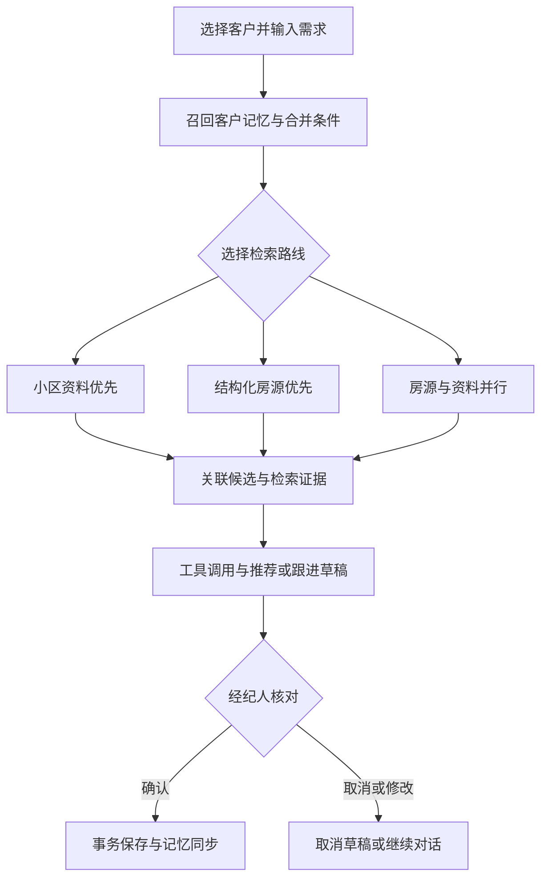

# 房产经纪智能助手 · Real Estate Agent

面向房产经纪工作流程的本地桌面 Agent：理解客户需求，联合检索结构化房源与小区资料，生成带依据的推荐和跟进草稿，再由经纪人确认保存。

**Python 3.13 · Tkinter · LangGraph · SQLite · BGE · Chroma · BM25 / RRF / MMR · Redis（可选）**

## 实现了什么

- **业务工作流**：支持先找小区、先筛房源、双路并行和指定房源查阅，由 LangGraph 管理状态与人工确认。
- **混合检索**：房源硬条件用 SQL 筛选；小区资料使用 BGE 稠密召回和 BM25 词法召回，经过 RRF 融合与 MMR 去重，保留来源信息。
- **客户记忆**：管理语义背景、购房情景、偏好版本及原文证据，按经纪人、客户和会话限制访问范围。
- **写入控制**：推荐、跟进和显式记忆草稿经过人工确认；无草稿回合另有自动记忆提取路径。宿主负责参数校验、权限、硬条件、事务和幂等，模型不能直接操作数据库。
- **故障恢复**：SQLite 检查点恢复待确认流程；记忆同步失败保留补偿任务；Redis 不可用时降级为进程内缓存。
- **可复现检查**：提供本地自动化测试、无需模型密钥的自检，以及独立的脚本化回归和在线模型评测入口。

这是一个单 Agent 的桌面作品项目。Skill 文件提供按需读取的业务指引，不代表多个独立 Agent；当前没有远程服务端、账号登录或多机器部署。

## 工作流程



## 快速启动

推荐在 Windows 10/11、Python 3.13（包含 Tkinter）环境下运行。

```powershell
python -m venv .venv
.\.venv\Scripts\Activate.ps1
python -m pip install -r requirements.txt
Copy-Item .env.example .env
```

编辑本机 `.env`，填写 `OPENAI_API_KEY`、`PROPERTY_MODEL` 和 `OPENAI_BASE_URL`。支持智谱、DeepSeek、OpenAI 及本地 OpenAI 兼容服务，端点限制见 [使用说明](使用说明.md)。自然语言对话需要有效的模型配置。

```powershell
python property_assistant.py
```

首次启动会生成 20 个小区、200 套房源、120 篇主题资料和 10 个客户的开发数据。这些是合成内容，并非真实客户资料或经核验的挂牌信息。

### 模型与缓存

- 源码仓库不上传 embedding 权重。默认尝试加载 `BAAI/bge-small-zh-v1.5`，首次使用需要下载；也可以将权重放在 `models/bge-small-zh-v1.5/`，或设置 `EMBEDDING_MODEL` 指向本地目录。
- BGE 加载失败会回退到确定性的字符特征向量，检索质量会下降；Chroma 不可用时可用 SQLite 向量检索。
- Redis 可选，默认地址为 `redis://127.0.0.1:6379/0`。没有 Redis 也能运行，此时缓存仅在当前进程内共享。

## 检查与评测

以下两项使用内部模型替身，不需要真实模型 API，也不代表在线模型效果：

```powershell
python run_checks.py
python property_assistant.py --self-check eval_results/self-check.json
```

测试结果写入本机 `checks.json`，以实际运行报告为准。完整检查包含 Tkinter 界面测试，需要可用的桌面会话；跨实例缓存恢复项需要 Redis，未连接 Redis 时会明确跳过该项。

能力评测提供 9 类场景，每类默认 100 条，覆盖推荐、资料检索、客户记忆、资料录入、多轮对话、确认、跟进、隔离和故障处理。

```powershell
# 脚本化宿主流程回归
python -m real_estate_desktop.eval.run --suite capability --mode scripted --out eval_results/scripted-900.json

# 真实模型评测：需要可用的密钥和模型，会产生 API 调用费用
python -m real_estate_desktop.eval.run --suite capability --mode online --out eval_results/online-900.json
```

脚本化检查、程序评分和模型质量是不同口径。仓库不以本地测试通过率替代真实模型成功率，也不附带未经复核的线上性能承诺。评测定义与限制见 [评测说明](real_estate_desktop/eval/README.md)。

## 代码导航

| 路径 | 作用 |
| --- | --- |
| `property_assistant.py` | 桌面启动与自检入口 |
| `real_estate_desktop/app.py` | Tkinter 界面 |
| `real_estate_desktop/workflow.py` | LangGraph 状态与流程编排 |
| `real_estate_desktop/runtime.py` | 运行时服务组装 |
| `real_estate_desktop/tools.py` | 工具协议、参数校验与执行边界 |
| `real_estate_desktop/knowledge.py`、`retrieval.py` | 资料管理与混合检索 |
| `real_estate_desktop/memory.py`、`typed_memory.py` | 客户长期记忆与偏好管理 |
| `real_estate_desktop/skills/` | 业务 Skill 指引 |
| `real_estate_desktop/tests/` | 本地工程与界面检查 |
| `real_estate_desktop/eval/` | 场景生成、评分器与评测入口 |
| `vendor/agent_memory/` | 随项目提供的第三方记忆组件 |

更完整的业务设计见 [项目说明](项目说明.md)，工程边界见 [工程说明](工程说明.md)，安装、导入和打包见 [使用说明](使用说明.md)。第三方组件声明见 [THIRD_PARTY_NOTICES.md](THIRD_PARTY_NOTICES.md)。

## 数据与使用边界

密钥、本机数据库、导入资料、模型权重、运行日志和评测输出均不纳入版本控制。实际使用时，模型接口会接收完成任务所需的对话及相关资料，请在导入真实数据前确认服务与数据处理要求。

本项目用于学习、作品展示和本地验证。客户数据保存在本机，当前没有数据库文件加密；经纪人标识与代码中的数据隔离也不能替代服务端认证。房产、配套和入学相关内容均需人工核验。
